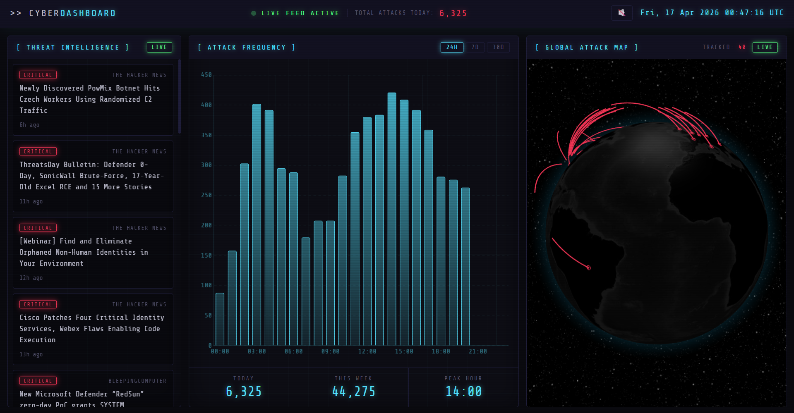

# >> CYBER**DASHBOARD**

> A real-time cybersecurity monitoring dashboard with a live threat intelligence feed, attack frequency charts, and an interactive 3D global attack map.


<!-- Replace docs/preview.png with a screenshot of your dashboard -->

---

## Features

- **Live Threat Intelligence Feed** — pulls real articles from The Hacker News, BleepingComputer, and CISA. Auto-classifies severity (CRITICAL / WARNING / INFO) by keyword analysis. Refreshes every 5 minutes.
- **Interactive 3D Globe** — real-time attack arcs sourced from AbuseIPDB's blacklist. Color-coded by severity. Drag to rotate, scroll to zoom.
- **IP Drill-Down Panel** — click any attack arc to open a full AbuseIPDB report: abuse score, ISP, domain, TOR status, attack categories, and recent report comments.
- **Attack Frequency Chart** — neon Chart.js bar chart with 24H / 7D / 30D toggle. Historical data stored in SQLite and accumulates over time.
- **Boot Sequence Animation** — terminal-style system initialization on every load.
- **Sound Engine** — toggleable Web Audio alerts: boot chime, critical attack alarms, news alerts.
- **Live Attack Counter** — topbar odometer ticking up in real time.
- **Dark Hacker Theme** — scanline overlay, neon glow effects, monospace font, pulsing LIVE badges.
- **Mobile Responsive** — stacks to single column on small screens.

---

## Preview

| Panel | Description |
|---|---|
| Left | Live cyber news feed with severity tags |
| Center | 24H/7D/30D attack frequency chart |
| Right | Interactive 3D globe with real attack arcs |

---

## Tech Stack

| Layer | Technology |
|---|---|
| Server | Node.js + Express |
| Database | SQLite via better-sqlite3 |
| Globe | Globe.gl + Three.js |
| Chart | Chart.js |
| News | rss-parser + node-fetch |
| Threat Data | AbuseIPDB API |
| Font | Share Tech Mono (Google Fonts) |

---

## Getting Started

### Prerequisites

- Node.js 18+
- A free [AbuseIPDB](https://www.abuseipdb.com/register) API key

### Installation

```bash
git clone https://github.com/artemusuni/CyberDashboard.git
cd CyberDashboard
npm install
```

### Configuration

Create a `.env` file in the root directory:

```env
ABUSEIPDB_KEY=your_api_key_here
```

### Run

```bash
npm start
```

Open [http://localhost:3000](http://localhost:3000) in your browser.

---

## Data & Caching

| Source | Cache | TTL |
|---|---|---|
| AbuseIPDB blacklist | `cache/attacks.json` + SQLite | 2 hours |
| IP drill-down reports | SQLite `ip_cache` table | 1 hour |
| RSS news feeds | In-memory | 5 minutes |

Attack data accumulates in `cache/attacks.db` over time, powering the 7D and 30D historical chart views.

---

## Project Structure

```
CyberDashboard/
├── server.js          # Express server + all API routes
├── db.js              # SQLite schema, queries, caching helpers
├── public/
│   ├── index.html     # Dashboard layout
│   ├── css/
│   │   └── style.css  # Dark hacker theme
│   └── js/
│       ├── boot.js    # Boot sequence animation
│       ├── sound.js   # Web Audio sound engine
│       ├── main.js    # Clock, news feed, chart
│       └── globe.js   # 3D globe + IP panel integration
├── cache/             # Auto-generated, gitignored
└── .env               # API keys, gitignored
```

---

## API Endpoints

| Method | Endpoint | Description |
|---|---|---|
| GET | `/api/live-attacks` | Top 100 malicious IPs from AbuseIPDB, mapped to arcs |
| GET | `/api/ip/:ip` | Full AbuseIPDB report for a specific IP |
| GET | `/api/attacks` | Generated hourly attack frequency for today |
| GET | `/api/history/:range` | Historical stats — `day`, `week`, or `month` |
| GET | `/api/news` | Latest articles from threat intelligence RSS feeds |
| GET | `/api/top-countries` | Top 10 attacker countries (last 7 days) |

---

## License

MIT
